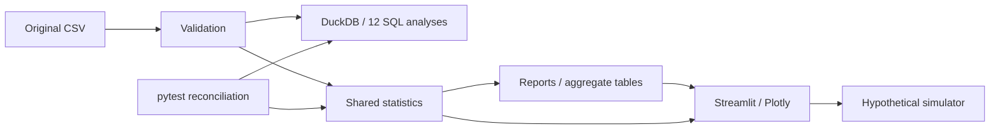
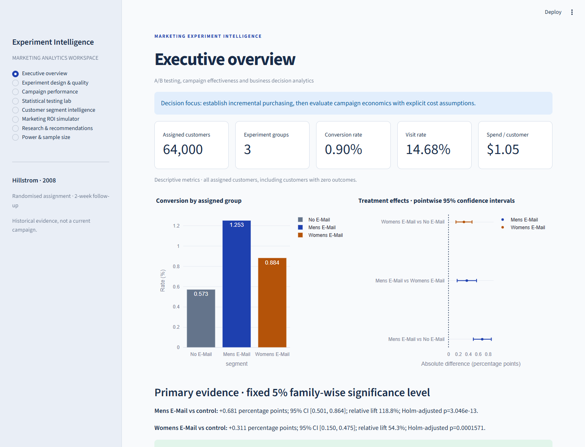
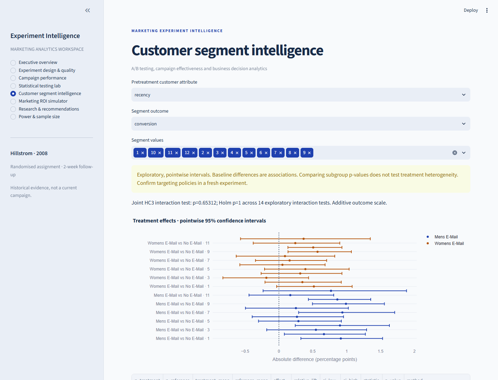
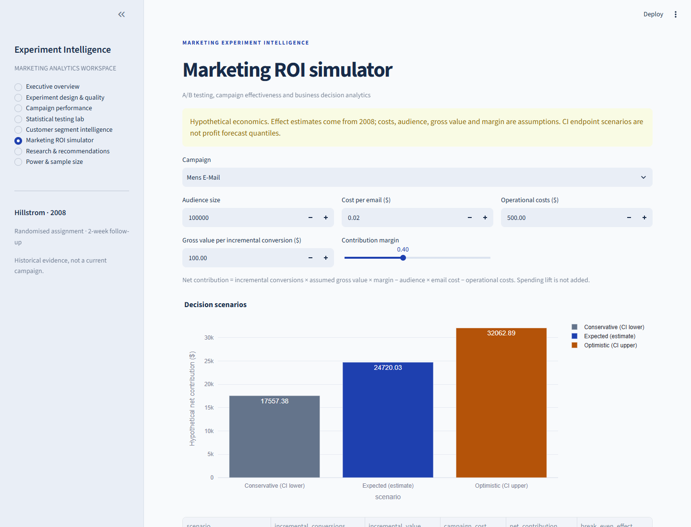

# Marketing Experiment Intelligence

A randomised marketing experiment evaluated through intention-to-treat estimates, SQL reconciliation and an interactive Streamlit decision workspace.

The retailer's question is whether promotional email causes incremental visits, purchases and spending. The no-email group measures outcomes that would occur without an email assignment. Conversion is the fixed primary outcome; visits and spending are secondary.

## Evidence and design

The original 2008 MineThatData challenge describes 64,000 customer assignments and two-week outcomes. This is a historical experiment, not a current campaign. Three original groups are retained: No E-Mail, Mens E-Mail and Womens E-Mail. See `reports/group_summary.csv` for exact denominators and `reports/analytical_report.md` for calculated findings.

Original source: https://blog.minethatdata.com/2008/03/minethatdata-e-mail-analytics-and-data.html

Dataset documentation: https://www.tensorflow.org/datasets/catalog/hillstrom

The original geographic category is spelled `Surburban`; no silent correction is applied. Data validation checks the original schema, categories, missingness, numeric ranges, binary fields and consistent conversion/visit/spend coding. Duplicate-looking customers remain because no identifier exists.

## Verified findings

| Assignment | Customers | Purchases | Conversion | Spending / customer |
|---|---:|---:|---:|---:|
| No E-Mail | 21,306 | 122 | 0.573% | $0.653 |
| Mens E-Mail | 21,307 | 267 | 1.253% | $1.423 |
| Womens E-Mail | 21,387 | 189 | 0.884% | $1.077 |

- Mens E-Mail: **+0.681 percentage points** (95% CI 0.501–0.864); relative lift 118.8%; Holm p=3.046e-13.
- Womens E-Mail: **+0.311 percentage points** (95% CI 0.150–0.475); relative lift 54.3%; Holm p=0.0001571.

Both assignments increased conversion in this historical experiment. Profitability depends on costs and margin assumptions. All reported uncertainty intervals are pointwise.

## Statistical methods

Two campaign/control conversion comparisons use two-sided tests with Holm family-wise correction at .05. Proportion tests use pooled z statistics with Fisher fallback for sparse expected cells. Newcombe intervals estimate absolute risk differences; log risk-ratio intervals support relative conversion/visit lifts. All 95% intervals are pointwise, not simultaneous. A separate seven-test Holm family covers exploratory direct campaign conversion, visits and spending comparisons.

Mean spending includes every assigned customer. Welch inference and an empirical 2,000-draw percentile bootstrap address skew and zeros without substituting median/rank estimands. Fixed seeds and multinomial resampling of the empirical support reduce memory. Baseline SMDs and allocation goodness-of-fit diagnose potential issues but cannot certify randomisation. Fourteen HC3 joint interaction tests use an exploratory Holm family; subgroup intervals alone do not justify targeting.

The ROI simulator uses conversion assignment effects with explicit hypothetical audience, cost, gross conversion value and margin. It applies margin once and does not add spending value. The prospective power planner uses independent proportions and conservative Bonferroni alpha across campaign/control comparisons.

## Working application

Eight workspaces: executive overview; design and quality; campaign performance; statistical lab; segment intelligence; ROI simulator; research downloads; power and sample size. Plotly charts show allocation, outcome rates, absolute and relative effects, pointwise interval forests, spending distribution, baseline balance, subgroups and hypothetical scenarios. Fixed primary decisions remain visible when exploratory display settings change. No opens, clicks or invented daily trends appear.

## Reproduce on Windows 11

Use Python 3.12 and PowerShell in this repository:

```powershell
py -3.12 -m venv .venv
.\.venv\Scripts\python.exe -m pip install -r requirements-lock.txt
.\.venv\Scripts\python.exe pipeline.py
.\.venv\Scripts\python.exe -m pytest -q
.\.venv\Scripts\python.exe -m streamlit run app/main.py
```

`requirements.txt` pins the direct dependencies; the supplemental lock pins transitive packages tested on Python 3.12/Windows. Neither requires paid services. If source acquisition fails, no synthetic fallback is used. Obtain the original CSV lawfully and place it at `data/raw/hillstrom.csv`, then rerun the pipeline.

## SQL and architecture

Twelve commented queries cover counts, proportions, visits, conversions, total spend, mean spend, absolute effects, relative effects, historical-spending groups, channel, recency and newbie status. Every query output is independently reconciled against Pandas in pytest.



```text
app/main.py              Streamlit entry point
src/data.py              Immutable acquisition and validation
src/statistics.py        Effects, inference, integrity, segments, power
src/simulations.py       Hypothetical contribution economics
src/visualisation.py     Plotly presentation transforms
src/sql/                 12 documented DuckDB queries
pipeline.py              Reproducible analysis and reports
reports/                 Actual aggregate findings and audit
assets/                  Architecture and actual dashboard captures
data/                    Dictionary, rights, ignored customer records
notebooks/               Interactive analysis entry-point guidance
tests/                   Independent analytics and app checks
```

## Verification and deployment

See `reports/technical_audit.md` and `reports/pytest.txt` for actual verification status, and `DEPLOYMENT.md` for local/cloud setup. The project is prepared locally; public hosting requires owner approval and data-hosting clearance. No remote repository or deployment is created automatically. Resource use is designed for a small customer table, but deployment hardware must be profiled before claiming a specific memory ceiling.

## Limitations and data rights

Original CSV redistribution rights are not explicitly established. Raw and processed customer-level data and DuckDB files are ignored by Git. See `data/DATA_RIGHTS.md` and `data/provenance.json`. The TensorFlow documentation licence is not assumed to cover source customer data. Historical context, no exact assignment code, no customer IDs, no opens/delivery/costs and no longitudinal timestamps restrict conclusions. Recorded completeness cannot rule out upstream attrition. Subgroup exploration and heavy-tailed spending require caution. Non-significance is not equivalence; significance is not profitability.

## Authorship and assistance

The project brief and requested analytical decisions were supplied by the project owner. Implementation, statistical code, reports and automated checks were generated with an OpenAI Codex coding assistant. Dataset authorship remains with Kevin Hillstrom / MineThatData. No manual human statistical review, independent external audit, commercial impact or deployment achievement is claimed. The owner should review findings and licensing before public portfolio publication.

## Dashboard screenshots

Actual local Streamlit captures, using the original customer data and calculated results.






