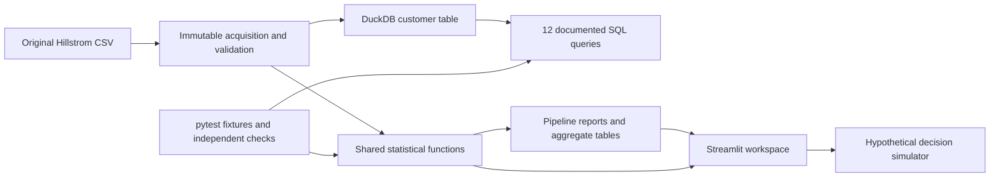

# Architecture

Data layer: src/data.py. Statistics and integrity: src/statistics.py. Hypothetical economics: src/simulations.py. SQL: src/sql/. Chart transforms: src/visualisation.py. Reproducible orchestration: pipeline.py. Presentation: app/main.py. Reports and dashboard consume the same estimates; app lab confidence changes invoke the shared comparison function, with fixed family decisions retained from pipeline outputs.
